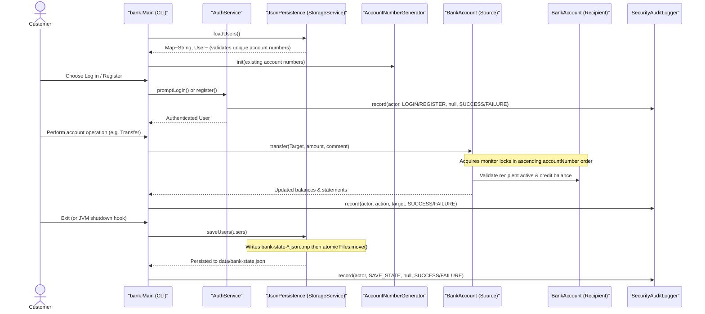
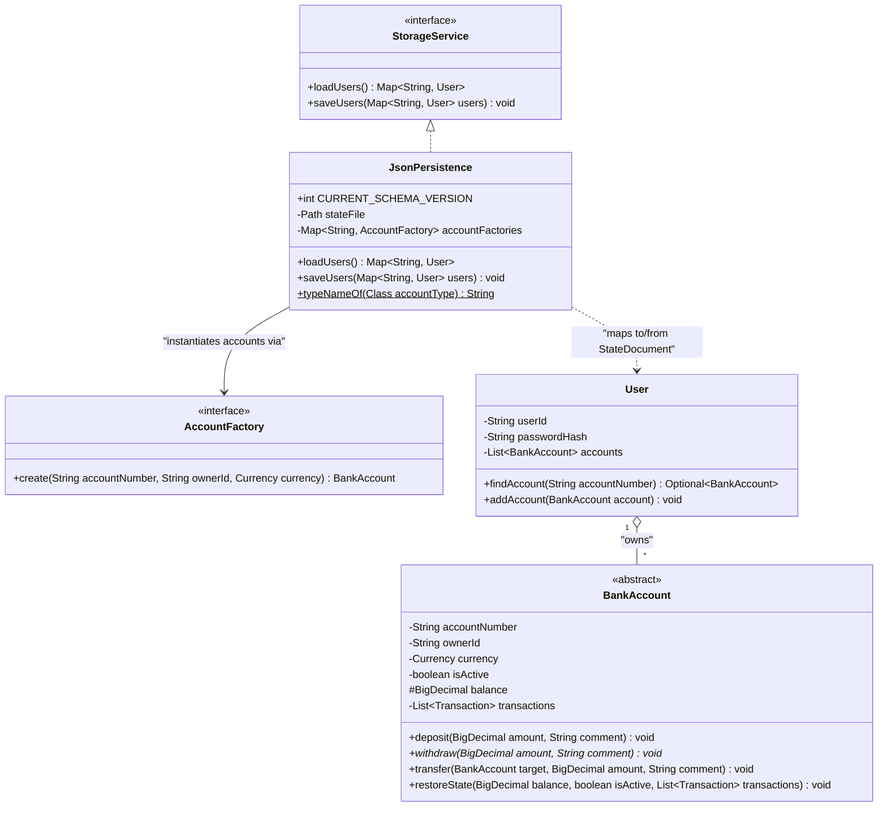

# System Architecture

> **Related Discussion:** [Issue #3 — Draft high-level system architecture](https://github.com/iaRka-Git/BankingProject/issues/3)  
> **Foundation Decisions:** [Issue #1 (Objectives & Core Features)](https://github.com/iaRka-Git/BankingProject/issues/1) · [Issue #2 (Data Storage Approach)](https://github.com/iaRka-Git/BankingProject/issues/2)

## 1. Architectural Goals & Context

Per the architectural baseline established in **Issue #1** and **Issue #2**:

- **Modular, UI-independent banking core:** Account rules, balances, currency handling, and thread-safe transfers live inside `bank` and `bank.account` without depending on console I/O or JSON files.
- **Storage abstraction (`StorageService`):** Persistence is hidden behind an interface so the MVP uses atomic local JSON serialization (`JsonPersistence` via Jackson Databind) while keeping a clean migration path to a relational database (`DatabaseStorage`) in a later phase.
- **Future client & admin separation:** Keeping authentication (`AuthService`), domain entities (`User`, `BankAccount`), and storage (`StorageService`) decoupled allows replacing or adding a REST API / admin console alongside the `bank.Main` CLI without rewriting core business logic.
- **Separation of logs and security audit:** Technical diagnostics go to `logs/bank.log` without sensitive customer data, while security and monetary outcomes are written to a dedicated JSON Lines audit trail (`logs/security-audit.jsonl`).

---

## 2. High-Level Layered Architecture

The diagram below illustrates the relationships between the user interface, application/domain logic, cross-cutting observability, and data storage.

```mermaid
flowchart TB
    subgraph UI["Presentation / UI Layer"]
        CLI["bank.Main (Interactive Console CLI)"]
        FutureAPI["Planned: Client REST API & Admin Console"]
    end

    subgraph App["Application & Authentication Layer"]
        Auth["bank.AuthService (SHA-256 + Constant-Time Verify)"]
        UserEntity["bank.User (Profile & Owned Accounts)"]
        AcctGen["bank.account.AccountNumberGenerator (Sequential UA + 18 digits)"]
    end

    subgraph Domain["Domain Core (bank.account & bank)"]
        BaseAcct["BankAccount (Abstract, Synchronized Ops, Lock-Ordered Transfer)"]
        Checking["CheckingAccount (Zero Overdraft Floor)"]
        Credit["CreditAccount (Credit Limit & Monthly Interest)"]
        Deposit["DepositAccount (Maturity Lock, Early Penalty & Accrual)"]
        Tx["BankAccount.Transaction (Amount, Timestamp, Comment)"]
        Curr["bank.Currency (EUR, USD, UAH)"]
    end

    subgraph Obs["Observability & Security Audit (bank.logging)"]
        TechLog["BankLogging -> Console & logs/bank.log (No PII/Amounts)"]
        AuditLog["SecurityAuditLogger -> logs/security-audit.jsonl (JSON Lines)"]
    end

    subgraph Storage["Data Storage Layer (bank.storage)"]
        Port["StorageService (Interface: loadUsers / saveUsers)"]
        Factory["AccountFactory (Interface: Type -> BankAccount)"]
        Json["JsonPersistence (Schema v1 DTOs + Atomic Temp-File Move)"]
        JsonFile[("data/bank-state.json")]
        FutureDB[("Planned: Relational Database Adapter")]
    end

    CLI --> Auth
    CLI --> UserEntity
    CLI --> AcctGen
    CLI --> Port
    CLI --> TechLog
    CLI --> AuditLog

    FutureAPI -.-> Auth
    FutureAPI -.-> UserEntity
    FutureAPI -.-> Port

    Auth --> UserEntity
    Auth --> AuditLog
    Auth --> TechLog

    UserEntity "1" o-- "0..*" BaseAcct
    BaseAcct <|-- Checking
    BaseAcct <|-- Credit
    BaseAcct <|-- Deposit
    BaseAcct "1" *-- "0..*" Tx
    BaseAcct --> Curr

    Port <|.. Json
    Port <|.. FutureDB
    Json --> Factory
    Json --> JsonFile
    Json -. "Restores via restoreState()" .-> BaseAcct
```

---

## 3. Runtime & Interaction Flows

### Startup, Authentication, Monetary Operation & Shutdown Persistence



---

## 4. Domain & Storage Decoupling

`JsonPersistence` intentionally maps domain objects (`User`, `BankAccount`, `BankAccount.Transaction`) to dedicated schema records (`StateDocument`, `UserRecord`, `AccountRecord`, `TransactionRecord`) instead of serializing domain classes directly. This guarantees:

1. **Schema stability:** Refactoring internal domain fields does not silently break saved JSON files (`CURRENT_SCHEMA_VERSION = 1`).
2. **Extensible account polymorphism:** Concrete subclasses register an `AccountFactory` under a type name derived from `JsonPersistence.typeNameOf(...)` (e.g., `CheckingAccount` -> `CHECKING`).
3. **Integrity checks on load:** Duplicate account numbers across users throw `StorageException` immediately on startup without modifying the state file.



---

## 5. Key Architectural Decisions

| Area | Current Implementation | Rationale / Evolution Path |
| --- | --- | --- |
| **Authentication** | `AuthService` hashes passwords with SHA-256 hex and verifies via `MessageDigest.isEqual` (constant-time). | Prevents timing side-channels and never stores plain-text passwords in memory or JSON; salted KDF (e.g., Argon2/PBKDF2) can drop into `AuthService`. |
| **Concurrency** | Account mutations are `synchronized` on the `BankAccount` monitor; `transfer(...)` orders locks lexicographically by `accountNumber` and validates recipient state before debiting. | Prevents lost updates, partial debit-without-credit states, and AB-BA deadlocks across concurrent operations (`BP-009`). |
| **Account Numbering** | `AccountNumberGenerator` issues sequential `UA` + 18-digit identifiers using an `AtomicLong` seeded above the highest persisted number. | Guarantees unique, non-colliding account IDs across users and restarts while preserving legacy IDs (`BP-010`). |
| **Persistence** | `JsonPersistence` serializes versioned DTOs to a sibling `.json.tmp` file and atomically replaces `data/bank-state.json`. | Eliminates partial/corrupted state writes on crash while keeping the `StorageService` boundary ready for a future SQL database implementation. |
| **Logging & Audit** | `BankLogging` sends compact UI prompts to stdout and stack traces/system events to `logs/bank.log`; `SecurityAuditLogger` writes structured JSON Lines (`timestamp`, `actor`, `action`, `target`, `status`) to `logs/security-audit.jsonl`. | Keeps PII, passwords, and monetary amounts out of technical logs and audit streams while preserving full traceability. |
